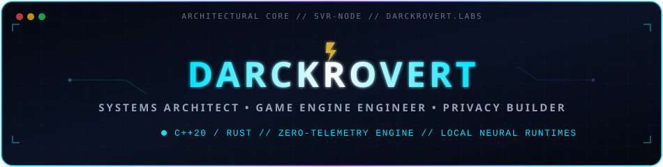

  

  
  
  
  
  
  

---

## 🧭 Sobre mí / About Me

¡Hola! Soy **DarckRovert** (conocido en comunidades de emulación y desarrollo de sistemas como *Elnazzareno*).  
Soy un **Arquitecto de Sistemas e Ingeniero de Software** especializado en el desarrollo de motores de videojuegos de alta concurrencia, protocolos criptográficos P2P descentralizados y la integración de modelos neuronales locales en entornos de ejecución en tiempo real.

### Principios Fundamentales de Ingeniería:
- 🛡️ **Cero Telemetría y Privacidad Radical:** El software pertenece y sirve exclusivamente al usuario. Rechazo frontal a telemetrías encubiertas, rastreadores y vigilancia corporativa.
- ⚡ **Rendimiento Nativo de Bajo Nivel:** C++ moderno (C++17/C++20), Rust para memoria concurrente segura, mitigación de colisiones de caché L1/L2/L3 y disciplina estricta de memoria virtual en 32 y 64 bits.
- 🧠 **IA Local Soberana:** Inferencia de modelos de lenguaje grandes (LLMs locales) desacoplada en tiempo real mediante colas no bloqueantes sin dependencias de APIs en la nube.
- 🔓 **Código Abierto y Soberanía Tecnológica:** Democratización de herramientas avanzadas para que comunidades y desarrolladores puedan comunicarse, crear e investigar con libertad absoluta.

---

## 🛠️ Stack Tecnológico & Competencias Clave

  

### Lenguajes de Sistemas & Arquitectura

### Audio Espacial, Gráficos & Redes en Tiempo Real

### Persistencia, Infraestructura, IA & DevOps

---

## 🚀 Proyectos Insignia / Flagship Projects

| Proyecto Insignia | Rol Arquitectónico & Especialidad | Stack & Enfoque | Acceso Oficial |
| :--- | :--- | :--- | :--- |
| **[RED](https://github.com/DarckRovert/RED)** | **Mensajería P2P Descentralizada Zero-Knowledge** Protocolo de comunicación cifrada de extremo a extremo sin servidores centrales, bases de datos intermediarias ni recolección de metadatos. |    |  |
| **[mod-playerbots](https://github.com/DarckRovert/mod-playerbots)** | **IA Táctica AAA & Multithreading para Bots (C++)** Simulación de combate humano calibrada (220–360 ms de latencia perceptual), evasión proactiva de áreas de daño y selección multihilo. |    |  |
| **[mod-llm-chatter](https://github.com/DarckRovert/mod-llm-chatter)** | **Inferencia Conversacional Local (LLM) en Tiempo Real** Integración de modelos neuronales locales (LM Studio / Ollama) desacoplados mediante colas asíncronas no bloqueantes en MySQL y habla contextual. |    |  |
| **[ProjectJaina_Voice](https://github.com/DarckRovert/ProjectJaina_Voice)** | **Audio Espacial 3D WebRTC In-Game (HRTF)** Gateway posicional en tiempo real con paneo estéreo HRTF y atenuación logarítmica de distancia para World of Warcraft 3.3.5a. |    |  |

---

### 🌟 Ecosistema JainaCore — Servidor MMORPG de Nueva Generación
> **El primer ecosistema de servidor World of Warcraft (WotLK 3.3.5a) con LoreBots Neuronales, IA Táctica AAA y Audio Espacial 3D Nativo.**

* **[mod-playerbots](https://github.com/DarckRovert/mod-playerbots):** Simulación táctica de jugadores en C++ con latencia perceptual humana calibrada (220–360 ms), evasión dinámica de áreas de daño en suelo (AoE), tope progresivo de talentos por expansión (31/41/51 pts), protección de Campeones Soberanos Persistentes y blindaje multihilo.
* **[mod-llm-chatter](https://github.com/DarckRovert/mod-llm-chatter):** Inferencia conversacional en tiempo real (LM Studio / Ollama) desacoplada mediante colas asíncronas no bloqueantes en MySQL, memoria de contexto por jugador y habla reactiva por proximidad.
* **[mod-ale](https://github.com/DarckRovert/mod-ale):** Motor de scripting Eluna extendido con bindings nativos en C++ para control táctico de bots y orquestación de eventos de mundo.
* **[mod-anticheat](https://github.com/DarckRovert/mod-anticheat):** Sistema de vigilancia cinemática y detección pasiva de anomalías de movimiento.
* **JainaCore Engine & Server Infrastructure (Infraestructura de Núcleo Soberano):** Arquitectura C++20 multi-nodo de alta concurrencia (`Errors.log = 0B`), prevención activa anti-split-brain con candado de mantenimiento atómico y motor autónomo **Chrono-Master v2.0** con calendario progresivo oficial 2026–2028 (Vanilla Cap 60 → TBC Cap 70 → WotLK Fases T7–T10.5 → Cataclysm).
* **Project Jaina Lab & DevOps Gateway (Infraestructura Privada):** Orquestador de microservicios, gateway de señalización WebRTC para audio 3D y distribución automatizada de parches.
* 🌐 **[Portal Oficial de Project Jaina](https://darckrovert.github.io/ProjectJaina_Web/)** — Web oficial, documentación de reinos y centro de descargas.

---

### 🛡️ [RED](https://github.com/DarckRovert/RED) — Red de Mensajería Descentralizada y Anti-Censura
> **Sistema de comunicación privada P2P de conocimiento cero (Zero-Knowledge) construido en Rust.**

- **Topología Descentralizada:** Comunicación cifrada directa sin servidores centrales, bases de datos intermediarias ni recolección de metadatos.
- **Soberanía Criptográfica:** Cifrado autenticado de extremo a extremo diseñado para proteger la libertad de expresión y la privacidad individual.
- **Resistencia a la Censura:** Canal seguro, transparente y portable que opera sin intermediarios comerciales ni vigilancia corporativa.

---

### 🎮 Suite Completa de AddOns para WoW 3.3.5a (25 Repositorios Oficiales)
AddOns de alto rendimiento para el cliente WotLK 3.3.5a con cero advertencias de FrameXML, arquitectura modular y calibración DirectX 9:

| Categoría | AddOn Suite | Especialidad / Rol Arquitectónico | Enlace |
| :--- | :--- | :--- | :--- |
| **Social & Audio** | **[ProjectJaina_Companion](https://github.com/DarckRovert/ProjectJaina_Companion)** | Hub social ligero, barra táctica de combate y formaciones |  |
| | **[ProjectJaina_Voice](https://github.com/DarckRovert/ProjectJaina_Voice)** | Sincronización in-game para audio espacial 3D WebRTC (HRTF) |  |
| | **[ProjectJaina_Radio](https://github.com/DarckRovert/ProjectJaina_Radio)** | Suite de streaming y radio multimedia in-game |  |
| | **[ProjectJaina_Polyglot](https://github.com/DarckRovert/ProjectJaina_Polyglot)** | Traducción dinámica neuronal multilenguaje de canales de chat |  |
| **Gameplay & IA** | **[ProjectJaina_MultiBot](https://github.com/DarckRovert/ProjectJaina_MultiBot)** | GUI táctica para órdenes estratégicas, roles y reclutamiento de bots |  |
| | **[Chatter-Companion](https://github.com/DarckRovert/Chatter-Companion)** | Gestor in-game de personalidades, tono y memoria narrativa para bots con IA |  |
| | **[ProjectJaina_BattlePass](https://github.com/DarckRovert/ProjectJaina_BattlePass)** | Pase de Batalla estacional, misiones dinámicas y recompensas |  |
| | **[ProjectJaina_GameModes](https://github.com/DarckRovert/ProjectJaina_GameModes)** | Selector cinematográfico de modos de juego (Hardcore, Iron Man) |  |
| | **[ProjectJaina_LoreHUD](https://github.com/DarckRovert/ProjectJaina_LoreHUD)** | Subtítulos cinematográficos y HUD inmersivo de narrativa de bots |  |
| **Economía & Visuales** | **[ProjectJaina_Store](https://github.com/DarckRovert/ProjectJaina_Store)** | Tienda visual transaccional y marketplace integrado |  |
| | **[ProjectJaina_Wardrobe](https://github.com/DarckRovert/ProjectJaina_Wardrobe)** | Sistema integral de transfiguración y armario cosmético |  |
| | **[ProjectJaina_VisualShop](https://github.com/DarckRovert/ProjectJaina_VisualShop)** | Previsualizador 3D de modelos, auras y efectos visuales |  |
| | **[ProjectJaina_DragonflightUI](https://github.com/DarckRovert/ProjectJaina_DragonflightUI)** | Overhaul visual moderno estilo 10.x para cliente 3.3.5a |  |
| | **[ProjectJaina_Graphics](https://github.com/DarckRovert/ProjectJaina_Graphics)** | Calibración de renderizado y estabilidad de memoria D3D9 de 32 bits |  |
| | **[ProjectJaina_AbbreviatedStatus](https://github.com/DarckRovert/ProjectJaina_AbbreviatedStatus)** | Formateo numérico abreviado y legible de vida, maná y estados |  |
| **Bandas & Combate** | **[ProjectJaina_RaidSuite](https://github.com/DarckRovert/ProjectJaina_RaidSuite)** | Asistente integral de bandas multiclase y puente táctico |  |
| | **[ProjectJaina_DBM](https://github.com/DarckRovert/ProjectJaina_DBM)** | Suite de alertas tácticas de encuentros calibrada para JainaCore |  |
| | **[ProjectJaina_GearScore](https://github.com/DarckRovert/ProjectJaina_GearScore)** | Cálculo ligero y optimizado de nivel de equipamiento |  |
| | **[ProjectJaina_Talented](https://github.com/DarckRovert/ProjectJaina_Talented)** | Gestor avanzado de plantillas de talentos y asignación rápida |  |
| **GM, QA & Telemetría** | **[ProjectJaina_AdminTools](https://github.com/DarckRovert/ProjectJaina_AdminTools)** | Panel administrativo GM, control de baluartes y eventos de mundo |  |
| | **[ProjectJaina_GMGenie](https://github.com/DarckRovert/ProjectJaina_GMGenie)** | Suite de asistencia extendida para Game Masters |  |
| | **[ProjectJaina_IntiObjGPS](https://github.com/DarckRovert/ProjectJaina_IntiObjGPS)** | Editor por lotes de coordenadas GPS para objetos del mundo |  |
| | **[ProjectJaina_TBCBalance](https://github.com/DarckRovert/ProjectJaina_TBCBalance)** | Monitor de balance, composición y equilibrio de clases |  |
| | **[ProjectJaina_PrideTrace](https://github.com/DarckRovert/ProjectJaina_PrideTrace)** | Suite de pruebas de control de calidad y telemetría de red |  |
| | **[ProjectJaina_Carbonite](https://github.com/DarckRovert/ProjectJaina_Carbonite)** | Sistema cartográfico vectorial y navegación táctica satelital HD |  |

---

## 📊 Métricas & Actividad en GitHub

  

  
  
  
  

---

## 💖 Apoya el Ecosistema Abierto / Sponsors & Donations

> *"Construir un ecosistema de emulación masivo con modelos neuronales locales, audio espacial 3D y suites de cliente optimizadas bajo una filosofía radical de Cero Telemetría requiere infraestructura dedicada, hardware de pruebas de alta gama y cientos de horas de ingeniería de bajo nivel."*

Si el código de **Project JAIna**, **JainaCore**, nuestros 25 AddOns libres o mis proyectos de investigación criptográfica te han sido de utilidad, considera convertirte en patrocinador para garantizar la sostenibilidad y evolución continua de este ecosistema:

&nbsp;&nbsp;

  

| Nivel de Patrocinio | Aporte | Beneficio Principal |
| :--- | :--- | :--- |
| **Iniciado de Dalaran** | `$3 / mes` | Insignia oficial de Sponsor en GitHub + Rol `@Iniciado de Dalaran` en Discord. |
| **Guardián del Kirin Tor** | `$5 / mes` | Rol exclusivo en Discord + Acceso al canal privado `#sponsors-lounge`. |
| **Archimago de la Ciudadela** | `$10 / mes` | Nombre en los créditos de [Project Jaina Web](https://darckrovert.github.io/ProjectJaina_Web/) + Acceso anticipado a builds. |
| **Campeón de Theramore** | `$25 / mes` | Mención destacada en el lanzador oficial + Prioridad en atención técnica de arquitectura. |
| **Consejo de los Seis** | `$50 / mes` | Logo / Banner de patrocinador destacado en la web oficial + Canal directo de arquitectura técnica. |

---

## 💡 Ética de Ingeniería & Filosofía

> *"El código debe ser resiliente, transparente y construido para las personas. La tecnología debe potenciar la libertad y la creatividad humana, nunca restringirla ni mercantilizarla."*

- **Privacidad Ante Todo:** Cero telemetría encubierta, cero analíticas intrusivas, cero monetización de datos privados.
- **Empirismo y Excelencia:** Cada error se rastrea hasta su causa raíz absoluta en código fuente o ensamblador; cada cambio se valida en tiempo de ejecución.
- **Comunidad y Transparencia:** Documentación técnica exhaustiva, registros de cambios fidedignos y proyectos listos para producción para otros desarrolladores.

---

### 🤝 Conexión y Redes Oficiales

 

  Construido con pasión, precisión arquitectónica y compromiso open-source por <strong>DarckRovert</strong>.

